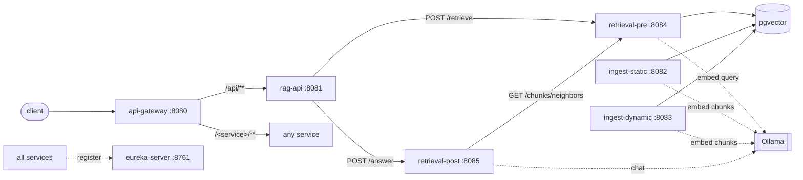

# Architecture

## Services

Services find each other through Eureka. Calls between services use `ServiceClients` (rag-platform), which
load-balances over the Eureka registry and propagates the trace id.

## Request flow for `POST /api/ask`

1. The gateway forwards `/api/**` to rag-api.
2. rag-api sends the query, the URL query parameters (as raw filters) and the per-request `stages` flags to
   retrieval-pre `POST /retrieve`.
3. retrieval-pre validates filters, adds `is_latest == true` unless the request asks for a version, normalizes and
   expands the query, embeds it with the active index's model,
   searches pgvector and returns the top-N candidates (default 20) with similarity scores.
4. rag-api sends the query and candidates to retrieval-post `POST /answer`.
5. retrieval-post reranks to top-k (default 5), fetches neighbor chunks from retrieval-pre, builds a prompt with
   citation headers, applies the similarity threshold ("I don't know" below it) and calls the chat model.
6. rag-api returns the answer, citations, ranked chunks, top similarity and per-stage timings.

A 4xx from a stage passes through to the client. Anything else from a stage becomes a 502.

## Storage

- Each embedding model has its own vector table, named `vector_store_<model>`, for example
  `vector_store_nomic_embed_text`. Spring AI's `PgVectorStore` creates it with a UUID id, `content`,
  `metadata json`, `embedding vector(N)` and an HNSW cosine index. `VectorStoreProvider` adds an index on
  `metadata->>'doc_id'`.
- `index_registry` lists the vector tables with their model and dimensions and marks the active one. A unique
  partial index allows at most one active row. Services cache the active index for 5 seconds.
- `ingestion_manifest` has one row per document version and table, with `source_type` `static` or `dynamic`. Both
  ingestion services write it through rag-store's `ManifestRepository`. Story 1 Task 4 extends it.
- Flyway migrations live in `rag-store/src/main/resources/db/migration`. Only ingest-static runs Flyway; other
  services wait for ingest-static to be healthy, which avoids several services racing to create the schema.

### Writing a document version

Both ingestion services write chunks through rag-store's `ChunkWriter`, in two steps:

1. Stage. The new chunks are added with `is_latest=false` and their version under `staged_version` instead of
   `version`. The embedding calls happen here, outside any transaction.
2. Publish. One short transaction retires the document's current chunks and reveals the new ones (`version` set,
   `is_latest=true`). `Retire.DELETE` removes the old chunks, for static documents. `Retire.FLAG` keeps them with
   `is_latest=false`, for dynamic documents with version history.

retrieval-pre adds `is_latest == true` to every search, and `ChunkQueries` skips rows with `staged_version`, so
queries never see staged chunks, a mix of versions or an empty document. If staging fails, the writer removes what
it added. If the publish transaction fails, it rolls back and the previous version stays. A crash between the steps
leaves staged rows that nothing reads; they keep their `doc_id`, so deleting the document removes them.

### Re-indexing with another embedding model (Story 1 Task 4)

`VectorStoreProvider.createIndex(model)` creates the new table next to the old one. Ingest everything into it, check
the counts against the manifest, then `IndexRegistry.activate(table)` switches every service in one transaction.
Queries never see a half-built index, and the old table stays for comparison until someone drops it. Allowed models
and their dimensions are listed in `rag.store.models`.

## Chunk metadata

Every chunk carries the keys in `MetadataKeys`: `doc_id`, `version`, `source`, `page`, `chunk_index`, `checksum`,
`is_latest`, `valid_from`, `embedding_model`, and for web sources `source_url` and `fetched_at`. ingest-static uses
`static:<filename>` as the `doc_id`; ingest-dynamic uses `web:<normalized URL>` and `repo:<owner>/<repo>/<path>`.

Both ingestion services chunk with the `rag-ingest` library (`PdfChunker`, `ChunkMetadata`, `Checksums`), so a
remote PDF is chunked the same way as a local one.

## Observability

With `make up-obs`, services export metrics, traces and logs over OTLP to the `grafana/otel-lgtm` container
(Grafana on http://localhost:3000, no login). Logs carry the trace id, so a slow `/api/ask` can be followed from the
gateway through rag-api, retrieval-pre and retrieval-post in Tempo and its log lines found in Loki. The dashboards
in the IAPC folder are generated by `scripts/gen-dashboards.py`.

Without the profile, logs go to the console only (`make logs`) and metrics are on each service's
`/actuator/prometheus`.
